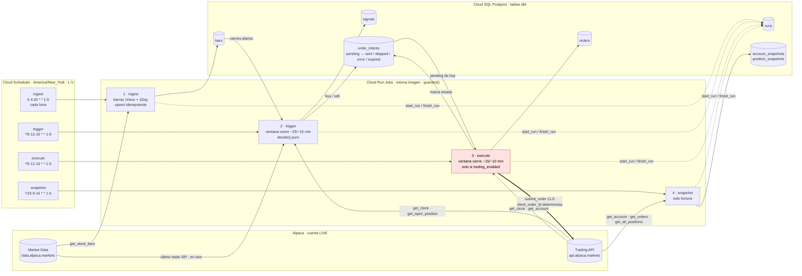

# 2026-11-07 — Arquitectura de 3 jobs: ingesta, trigger, ejecución

Estado: aceptada (2026-11-07). Pendiente de implementar.
Rama: `feat/three-jobs`
PR: —

## Problema

Hoy `trade_window` (`src/jobs.py`) hace todo en un solo job a ~15:45 NY: pide los datos a Alpaca,
decide y manda la orden. Además hay un job `snapshot` aparte. Esto tiene tres problemas:

- **Los datos no se guardan.** Cada run baja ~600 barras diarias, las usa y las tira. No hay
  histórico propio en Cloud SQL para analizar, backtestear con datos idénticos a los del bot ni
  auditar con qué datos se decidió.
- **Decisión y ejecución van pegadas.** No se puede pausar solo la ejecución y seguir viendo qué
  decidiría el bot, ni reintentar una orden fallida sin volver a decidir.
- **Un fallo en la parte de datos tumba la orden del día**, y viceversa.

Objetivo: separar en tres jobs con una única responsabilidad cada uno.

## Arquitectura propuesta

```
            cron horario            cierre −25/−15 min (get_clock)   cierre −15/−10 min (get_clock)
         ┌──────────────┐             ┌──────────────────┐         ┌───────────────────┐
Alpaca ─▶│ 1. ingest    │──▶ bars ───▶│ 2. trigger       │──▶ ────▶│ 3. execute        │──▶ Alpaca
 data    │ (solo lee    │  (Cloud SQL)│ decide() puro    │ order_  │ lee intents       │  submit_order
         │  Alpaca)     │             │ escribe signal + │ intents │ pending de hoy,   │  (CLS)
         └──────────────┘             │ order_intent     │         │ manda, marca sent │
                                      └──────────────────┘         └───────────────────┘
```



La única flecha gruesa (`==>`) es la única que mueve dinero: `execute → submit_order`.

| Job | Cron (NY) | Lee | Escribe | Llama a Alpaca |
|---|---|---|---|---|
| `ingest` | cada hora, `5 4-20 * * 1-5` | Alpaca Market Data | `bars` | Market Data (bars) |
| `trigger` | `*/5 12-16 * * 1-5` + ventana por `get_clock()` | `bars`, posición actual | `signals`, `order_intents` | `get_clock`, `get_open_position`, último trade (ver pendiente 2) |
| `execute` | `*/5 12-16 * * 1-5` + ventana por `get_clock()` | `order_intents` | `orders`, `order_intents.status` | `get_clock`, `get_account`, `submit_order` |

**Nada de crons fijos tipo "15:35".** Los días de media sesión (viernes de Thanksgiving, 24 de
diciembre…) el mercado cierra a las 13:00, y un cron fijo no operaría. Se mantiene el patrón
actual de `trade_cron`: el cron corre a menudo y es `in_submit_window(clock, …)`, con el
`next_close` real de `get_clock()`, quien decide si toca actuar. Las ventanas no se solapan:
`trigger` decide entre 25 y 15 min antes del cierre (una sola vez por sesión, gracias al
`client_order_id`), y `execute` envía entre 15 y 10 min antes, para cerrar antes del corte de
CLS.

- **Solo `execute` puede mandar órdenes**, y solo si `trading_enabled: true`. `ingest` y
  `trigger` no importan `submit_order`.
- `trigger` sigue usando `decide()` sin cambios: la estrategia no se toca.
- Todos pasan por `guarded()` (`runs`, `guard_live`, errores a `finish_run`).

### Tablas nuevas (modelos dbt)

`bars`, PK `(symbol, timeframe, ts)`: `symbol`, `timeframe` (`1Hour` / `1Day`), `ts` (inicio de
barra, timestamptz), `open`, `high`, `low`, `close`, `volume`, `trade_count`, `vwap`, `feed`,
`adjustment`, `ingested_at`, `run_id`. El upsert es idempotente: re-ingerir la misma hora no
duplica nada y corrige la barra si Alpaca la revisó.

`order_intents`, PK `client_order_id` (`scherman-spy-buy-2026-11-06`, el mismo formato que ya
existe): `signal_id`, `session_date`, `symbol`, `side`, `qty`, `status` (`pending` → `sent` |
`skipped` | `error` | `expired`), `created_at`, `executed_at`, `run_id` (de trigger),
`execute_run_id`, `detail`.

## Alternativas consideradas: cómo el job 2 dispara al job 3

### A. Tabla `order_intents` + cron propio del job 3 — **ELEGIDA**

El job 2 escribe una fila `pending`. El job 3 corre por su cron, ejecuta las `pending` de la
sesión de hoy y las marca.

Por qué:
1. **Durabilidad.** La decisión queda escrita antes de intentar ejecutarla. Si el job 3 falla, la
   intent sigue `pending` y la siguiente pasada (15:47) la reintenta. Cualquier otra opción
   también acaba necesitando esta tabla para poder reintentar, así que A es lo mínimo.
2. **Idempotencia.** "Ejecuta las pending y márcalas sent", más el `client_order_id`
   determinista y `sent_order()` que ya existen. Correr el job 3 dos veces no duplica órdenes.
3. **Auditoría.** `signals → order_intents → orders` deja ver qué se decidió, qué se intentó y qué
   llegó a Alpaca. Una intent `pending` vieja es una alarma visible.
4. **Sin IAM nuevo.** Cada job tiene su Cloud Scheduler, igual que `trade`/`snapshot` hoy. La
   cuenta del job no necesita permiso para lanzar otros jobs.
5. **Control operativo.** Pausar el scheduler de `execute` desarma la ejecución y deja que
   `trigger` siga registrando lo que haría. Es una segunda llave además de `trading_enabled`.

Coste asumido:
- **Latencia de hasta unos minutos** entre decidir y ejecutar. Irrelevante para una estrategia
  diaria que opera unas pocas veces al mes.
- **Dependencia del reloj.** Las órdenes CLS se aceptan hasta 10 min antes del cierre. Si
  `trigger` decide tarde, `execute` tiene menos pasadas para enviar. Se mitiga con ventanas
  escalonadas relativas a `next_close` (trigger −25/−15 min, execute −15/−10 min) y con el cron
  cada 5 min, que da 1–2 pasadas de `execute` por sesión. `execute` marca `expired` cualquier
  intent de una sesión anterior en vez de ejecutarla tarde.

### B. El job 2 lanza el job 3 por API (`jobs.run` de Cloud Run) — descartada

El job 2, tras decidir, llama a `POST .../jobs/moneybot-execute:run`.

- A favor: ejecución inmediata, sin margen muerto entre crons.
- En contra:
  - Necesita `roles/run.invoker` (o `run.jobs.run`) sobre el job 3 para la cuenta
    `moneybot-job`, y una llamada HTTP más que puede fallar.
  - Si la llamada falla o el job 3 se cae, sin una tabla de intents no queda constancia de qué
    había que ejecutar, así que acaba necesitando la tabla de A igualmente.
  - Acopla los dos jobs: no se puede pausar uno sin tocar el código del otro.

### C. Pub/Sub + Eventarc — descartada

El job 2 publica un mensaje en un topic, y un trigger de Eventarc arranca el job 3.

- A favor: desacople total y reintentos gestionados por Pub/Sub.
- En contra:
  - Tres piezas de infra nuevas (topic, subscription, trigger) y sus IAM, para un evento que
    ocurre unas pocas veces al mes.
  - Los reintentos de Pub/Sub no conocen la ventana de CLS: un reintento a las 15:55 llegaría
    tarde de todos modos.
  - Sobredimensionado para el volumen.

### Híbrido A + B — aparcada como upgrade

El job 2 escribe la intent (A) **y además** lanza el job 3 (B). El cron del job 3 queda como red
de seguridad.

- Latencia mínima con la durabilidad de A.
- Cuándo pasar a esto: si en la práctica el margen entre crons da problemas (intents que
  caducan sin ejecutarse). El cambio es aditivo: un permiso IAM y una llamada al final de
  `trigger`.

## Pendiente 1: qué guarda `ingest`

1. **Barras horarias + diarias en `bars`** (recomendada). Las diarias son las que usa `decide()`.
   El cierre diario oficial **no** se puede reconstruir desde las horarias, porque estas
   incluyen pre-market y after-hours (04:00–20:00) y la de 09:00 mezcla pre-market con la
   apertura.
2. Solo horarias, derivando el cierre diario de la sesión regular. Menos datos, pero el "cierre"
   derivado puede no coincidir con el oficial.
3. Horarias + diarias + absorber el snapshot de cuenta/posiciones, con lo que desaparece el job
   `snapshot`. Deja 3 jobs en total en vez de 4. Motivos para **no** hacerlo:
   - **Frecuencias distintas.** `snapshot` corre cada 15 min (`snapshot_cron`) y las barras
     horarias cambian una vez por hora. Juntarlas obliga a perder resolución en la curva de
     equity o a pedir barras 4 veces más de lo necesario.
   - **APIs y fallos distintos.** Market Data (`data.alpaca.markets`) frente a la Trading API
     (`api.alpaca.markets`). En un solo job, un fallo de una tumba la otra, salvo que se añada
     lógica de aislamiento.
   - **Datos distintos.** Las barras son re-descargables. El estado de la cuenta no se puede
     recuperar a posteriori.

   Un 4º job cuesta casi nada: es la misma imagen y una entrada más en `local.jobs`.

## Pendiente 2: de dónde saca `trigger` el precio de hoy

`trigger` corre a las 15:35. La última barra horaria cerrada es la de las 14:00 (la de 15:00
sigue abierta), así que lleva más de una hora de retraso.

1. **`trigger` pide el último trade en vivo a Alpaca** (recomendada). Es lo que se hace hoy, con
   el guard `STALE_TRADE` de 5 min. El histórico sale de Cloud SQL y solo el precio actual va en
   vivo.
2. `ingest` hace una pasada extra a las 15:30 que guarda el último trade, y `trigger` solo lee de
   la DB. Es más puro, pero `trigger` pasa a depender de que esa ingesta haya terminado a tiempo,
   y el precio llega ya con 5 min de antigüedad.

## Riesgos y cómo se cubren

- **`bars` vacía o atrasada** (falla `ingest`): `trigger` comprueba que tiene la barra diaria de
  ayer y ≥ `trend_window` cierres. Si no, falla el run con `stale_bars` y no escribe intent.
- **Intent ejecutada dos veces**: el `client_order_id` determinista, más `sent_order()`, más el
  error de duplicado de Alpaca, ya tratado.
- **Intent ejecutada tarde**: `execute` solo actúa sobre intents con `session_date` = sesión de
  hoy y dentro de `in_submit_window`. Las demás pasan a `expired`.
- **Transición**: el job `trade` actual se retira cuando `trigger` + `execute` estén desplegados.
  No deben convivir los dos armados, porque ambos podrían mandar la orden del día. El
  `client_order_id` compartido lo evitaría igualmente, pero mejor no depender de eso.

## Decisión

- Disparo 2→3: **A (tabla `order_intents` + cron propio)**, por durabilidad, idempotencia,
  auditoría, cero IAM nuevo y control operativo. B y C descartadas. El híbrido A+B queda como
  upgrade si la latencia llega a importar.
- Ingesta (pendiente 1): **opción 1, barras horarias + diarias en `bars`**. Se mantiene
  `snapshot` como job aparte, así que quedan **4 jobs**: `ingest`, `trigger`, `execute` y
  `snapshot`. Decidido el 2026-11-07.
- Precio de hoy (pendiente 2): **opción 1, `trigger` pide el último trade SIP en vivo**, con el
  guard `STALE_TRADE` de 5 min. Decidido el 2026-11-07: la cuenta tiene **Algo Trader Plus**, que
  da SIP en tiempo real. Con eso, `ingest` tampoco necesita dejar 15 min de margen respecto a
  "ahora". Si algún día se baja al plan Basic, ambos jobs fallarían: `trigger` por `STALE_TRADE`
  y `ingest` por pedir datos SIP de menos de 15 min. En ese caso habría que pasar a `feed=iex`.

## Seguimiento

- Código: `src/jobs.py` → `ingest`, `trigger`, `execute` (reusando `guarded`, `decide`,
  `fetch_*`, `upsert_order`). Modelos dbt `bars.sql` y `order_intents.sql`. Tests de `trigger` y
  `execute` con clientes de Alpaca mockeados.
- Infra (`infra/main.tf` `local.jobs`, `variables.tf` crons): **requiere confirmación explícita
  aparte** (AGENTS.md §0).
- Al aceptar: `brain/architecture/0003-three-jobs.md` y actualizar `brain/overview.md`.
