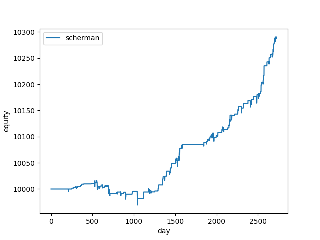
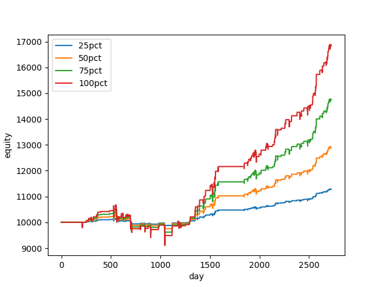
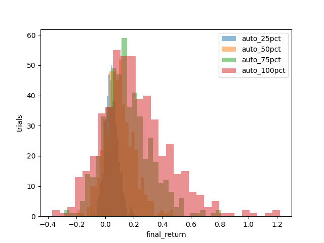
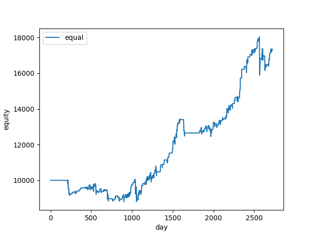
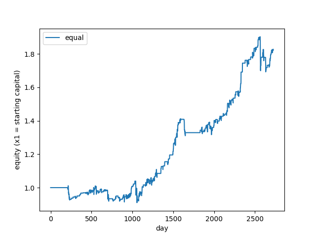
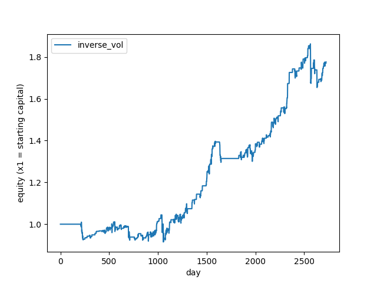
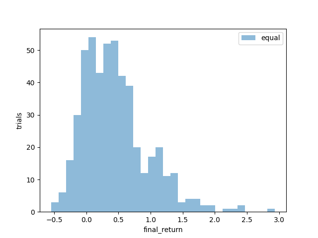

# Spike 2026-11-03 — Cuánto capital meter y en cuántos activos

Estado: exploración cerrada, sin cambios en el bot live
Rama: `exp/portfolio-rebalancing`
Código: `src/backtest.py` (`simulate_shares`, `monte_carlo_shares`), `src/portfolio.py`
(`simulate_portfolio`)
Propuestas relacionadas: [equal / inverse-vol](../proposals/2026-11-03-portfolio-rebalancing-equal-inverse-vol.md),
[HRP](../proposals/2026-11-03-hierarchical-risk-parity.md)

Las cifras de abajo están **leídas de los gráficos**, así que son aproximadas. Las cifras exactas
no se guardaron. Para obtenerlas hay que relanzar los scripts (ver "Cómo reproducir").

## Datos usados

- SPY diario de Alpaca, feed SIP, `Adjustment.SPLIT`. Se pidió desde 2010, pero el entitlement
  SIP recorta en silencio a unos 10,8 años, así que el histórico real son ~2.720 sesiones.
- Capital inicial: 10.000 $. Estrategia: Scherman (`trend_window=200`, `exit_window=5`,
  `down_days=3`).
- **No incluye dividendos** (solo se ajustan los splits). Penaliza a cualquier estrategia que
  pase mucho tiempo invertida, y no se tuvo en cuenta en ninguna comparación.

## Idea 1 — El bot real: 1 acción fija

El bot live compra `qty: 1`. Con 10.000 $ eso es invertir ~5–7 % del capital, y el resto queda
en efectivo sin hacer nada.



Resultado: unos +290 $ en ~10,8 años (≈ +2,9 %). La estrategia acierta la dirección, pero el
tamaño de la posición es tan pequeño que el resultado no se nota.

## Idea 2 — Comprar las acciones enteras que permita un % del equity

`simulate_shares(qty="auto", max_allocation=p)`: en cada entrada se compran
`floor(cash * p / precio)` acciones. Se probaron p = 25 %, 50 %, 75 % y 100 %.

### Pasado (backtest)



| max_allocation | Equity final aprox. | Retorno aprox. |
|---|---|---|
| 25 % | 11.300 $ | +13 % |
| 50 % | 12.900 $ | +29 % |
| 75 % | 14.750 $ | +48 % |
| 100 % | 16.850 $ | +69 % |

El retorno escala casi linealmente con el % asignado, y las caídas también (el valle de
~día 1.050 es más profundo cuanto más se asigna). No hay un "punto óptimo" escondido: solo se
elige cuánta exposición se quiere.

### Futuro sintético (Monte Carlo, bootstrap de retornos)

Primero con pocas rutas, después con **1.500 trials** por asignación (`seed=1`), para que los
percentiles p5/p95 fueran estables. Con unos cientos, las colas se movían de una corrida a otra.




- Todas las distribuciones están centradas en un retorno positivo pequeño. La mediana sube con
  el % asignado: de ~+5 % al 25 % a ~+15 % al 100 %.
- La dispersión crece con el % asignado. Al 25 % casi todo cae entre −10 % y +30 %. Al 100 %
  las colas van de −40 % a +120 %.
- Conclusión: más asignación = más retorno esperado **y** más riesgo, en proporción parecida. La
  decisión es de tolerancia al riesgo, no técnica.

## Idea 3 — Varios activos con reparto del capital

Scherman decide in/out **por símbolo**. `simulate_portfolio` reparte cada día el capital entre
los símbolos que están long:

- `equal`: 1/N entre los activos activos.
- `inverse_vol`: peso proporcional a 1 / volatilidad reciente de cada activo.





- Las dos terminan en torno a ×1,75–×1,8. Inverse-vol queda ligeramente por debajo de equal y
  con una forma casi idéntica: con una cesta tan correlacionada, ponderar por volatilidad apenas
  cambia los pesos.
- Más retorno que SPY solo al 100 % (×1,69), pero con caídas más bruscas al final de la serie.

Monte Carlo de la cartera `equal`:



Distribución mucho más ancha que la de SPY solo: mediana ~+30–40 %, cola izquierda hasta −50 %
y cola derecha hasta +290 %. La cartera multiplica tanto lo bueno como lo malo.

## Ideas sueltas que salieron por el camino

- **Granularidad de Alpaca**: hay barras de `1–59Min`, `1–23Hour`, `Day`, `Week` y `Month`, más
  trades y quotes tick a tick. Las barras horarias incluyen pre-market (04:00) y after-hours
  (hasta 20:00 NY), y la barra de 09:00 mezcla pre-market con la apertura. El bot solo usa
  `close` diario. Referencia: https://docs.alpaca.markets/reference/stockbars y
  https://alpaca.markets/sdks/python/api_reference/data/models.html#bar
- **Dividendos**: pasar el backtest a `Adjustment.ALL` (o sumar dividendos aparte) antes de
  comparar contra buy-and-hold. Hoy el backtest favorece injustamente a la estrategia que está
  fuera del mercado.
- **Quotes antes de la orden**: mirar el bid/ask para no mandar una orden market con un spread
  malo. En SPY tiene poco impacto.
- **HRP**: sigue aparcado (ver su propuesta). Con una cesta tan correlacionada, inverse-vol ya
  muestra que el reparto entre activos aporta poco.

## Decisión / siguiente paso

Nada de esto cambia el bot live (`trading_enabled: false`, `qty: 1`). Si se quiere sacar
partido a la Idea 2, el cambio mínimo sería que `trade_window` calcule `qty` como
`floor(equity * max_allocation / last)` en vez de leer un `qty` fijo. Eso necesita propuesta
propia en `brain/proposals/` y decidir el % (es decisión de riesgo del usuario).

## Cómo reproducir

Los scripts eran de un solo uso y vivían en el scratchpad de la sesión del 2026-11-03, que ya no
existe. El núcleo, con los imports actuales:

```python
from datetime import date
from functools import partial
from src.backtest import fetch_history, load_local_env, monte_carlo_shares, simulate_shares
from src.strategy import decide

load_local_env()
history = fetch_history("SPY", date(2010, 1, 1), date.today())
scherman = partial(decide, trend_window=200, exit_window=5, down_days=3)
simulate_shares(history, scherman, qty="auto", initial_capital=10_000.0, max_allocation=0.5)
monte_carlo_shares(history, scherman, qty="auto", initial_capital=10_000.0,
                   max_allocation=0.5, trials=1500, seed=1)
```
