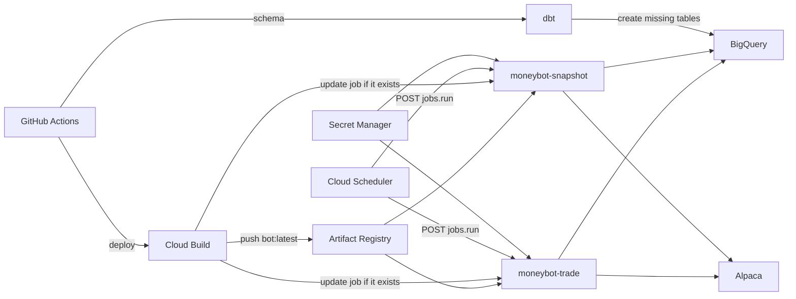

# moneybot

> Live Alpaca bot for **SPY**. It follows the market-on-close pattern Iván Scherman described publicly, and a second job only records the account. Nothing here runs on your laptop. GitHub Actions builds, migrates, and deploys it.

The 491% from 2023 is the futures World Cup. Those models are not published. This repo is the close replica from the [Business Insider interview](https://www.businessinsider.com/stock-trading-strategy-quant-fund-manager-competition-champion-sp500-return-2024-9): Scherman says his fund does not trade it, and the near copy is the SPY ETF. Execution is option 1 from that note, a market-on-close order.

## Contents

- [Rules](#rules)
- [Two jobs](#two-jobs)
- [Data](#data)
- [Deploy](#deploy)
- [Infrastructure](#infrastructure)

## Rules

The signal uses the last trade as today's close. The official close does not exist yet when the job decides. The auction can fill at a different price.

| Check | Action |
| --- | --- |
| Today's 200-day SMA is above yesterday's | Trend is on. The last trade counts as today's close |
| Third down day, and the last price is under yesterday's close | Buy `qty` shares with a `cls` order |
| Long, and the last price is above the 5-day SMA | Sell the whole position with a `cls` order |
| Anything else | Hold |

Also:

- No stop. Size is fixed (`qty`, default 1). If cash cannot cover `qty` times the last price, it does not buy. No margin. No fractions. Alpaca rejects a fractional `cls` order.
- One position. Already long means no buy. Flat means no sell.
- The same order is not sent twice. `client_order_id` is `scherman-spy-{buy|sell}-{date}`.
- The last trade must be under 5 minutes old, and the feed must be SIP. A stale trade or an IEX close aborts the run and sends nothing.

`trading_enabled` starts as `false` in [`config/bot.yml`](config/bot.yml). `false` stores the signal and does not send the order. Set it to `true`, push to `main`, and the new image picks it up.

`mode` other than `live`, or `APCA_API_BASE_URL` containing `paper`, aborts the process.

## Two jobs

One image. Two Cloud Run jobs. Two Cloud Scheduler triggers in `America/New_York`.

| Job | Default cron | What it does |
| --- | --- | --- |
| `moneybot-trade` | `*/5 12-16 * * 1-5` | Sends the order only when the close is more than 10 and at most 20 minutes away. That covers the 16:00 ET close and the 13:00 ET early close. Outside that window it does not touch orders |
| `moneybot-snapshot` | `*/15 9-16 * * 1-5` | Reads the account, positions, and open orders. It does not decide and it does not trade |

The crons are Terraform variables. If the trade job does not run inside the window, that session is not traded.

The picture of GCP, and which file owns which resource, is in [Infrastructure](#infrastructure).

## Data

BigQuery, dataset `moneybot` (location `US`). dbt creates the tables and views with `dbt build`. If a table already exists, dbt leaves it alone. A later column change is not applied to an existing table.

Every table is append-only: a change of state is a new row, never an `UPDATE`. The views `runs_latest`, `orders_latest`, and `order_intents_latest` give the current state. Ids are UUIDs. Why: [`brain/architecture/0003-bigquery.md`](brain/architecture/0003-bigquery.md).

| Table | One row is |
| --- | --- |
| `runs` | One event of a run: `running` when it starts, then `ok`, `skipped`, or `error` |
| `signals` | The price, both 200-day SMAs, the 5-day SMA, the flags, the action, the reason, and the strategy parameters (JSON) |
| `orders` | One event of a `cls` order sent to Alpaca |
| `account_snapshots` | Equity, cash, buying power, and open orders |
| `position_snapshots` | One open position |
| `bars` | One OHLCV bar per symbol, timeframe, and start time. Filled by the ingest job (next change) |
| `assets` | One instrument |
| `order_intents` | One event of an order intent. Used by the trigger and execute jobs (next change) |

Models and column tests are in [`dbt/`](dbt).

## Deploy

The GCP project already exists. The default region is `us-central1`. Cloud Scheduler must be available there. Cloud SQL `db-f1-micro` still exists but the jobs no longer use it. It is removed in a later change.

Create a service account named `moneybot-sa` and download the JSON. Before the first Deploy, grant that account **Storage Admin** and **Project IAM Admin**. Those two let it create the state bucket and then keep its other roles in Terraform. It does not need Owner. In the repo, open **Settings → Secrets and variables → Actions** and add:

| Name | Kind | Value |
| --- | --- | --- |
| `GCP_SA_KEY` | secret | The whole JSON key |
| `GCP_PROJECT_ID` | secret | The project id |
| `ALPACA_KEY` | secret | Alpaca key |
| `ALPACA_SECRET` | secret | Alpaca secret |
| `GCP_REGION` | variable | Optional. Workflows use `us-central1` when it is empty |

Terraform state lives in the bucket `PROJECT_ID-moneybot-tfstate`. Alpaca keys live in GitHub Secrets and in Secret Manager.

A push to `main` runs **Deploy**. That workflow calls [test.yml](.github/workflows/test.yml), then [infra.yml](.github/workflows/infra.yml) with action `infra`, then [build.yml](.github/workflows/build.yml). The apply creates Artifact Registry, the BigQuery dataset, Cloud SQL (unused), Cloud Build IAM, and the empty secrets. It does not create the jobs. If that apply fails because the Cloud Build account or the Scheduler agent does not exist yet, run **Deploy** again.

Then, from **Actions → Infra**, in this order:

1. Action `schema`. dbt creates the tables.
2. Action `secrets`. Loads the Alpaca keys into Secret Manager.
3. Action `jobs`. Creates `moneybot-trade`, `moneybot-snapshot`, and the two schedulers on `bot:latest`.

Every push and every pull request runs the tests. Every push to `main` publishes the image again. Changing [`config/bot.yml`](config/bot.yml), including `trading_enabled: true`, is a push to `main`.

## Infrastructure

GCP layout for moneybot. Terraform in `infra/` creates it.

### What `infra/` owns

| File | What it holds |
| --- | --- |
| [`terraform.tf`](infra/terraform.tf) | Terraform and provider version pins |
| [`backend.tf`](infra/backend.tf) | GCS state backend. The bucket name is passed at `init` |
| [`providers.tf`](infra/providers.tf) | Google provider, project, and region |
| [`variables.tf`](infra/variables.tf) | Inputs. An empty `image` skips the jobs |
| [`main.tf`](infra/main.tf) | Every resource |
| [`outputs.tf`](infra/outputs.tf) | Image repository and BigQuery dataset |

Two applies share this config:

| Apply | `image` | What appears |
| --- | --- | --- |
| `infra` | empty | APIs, registry, BigQuery dataset, Cloud SQL (unused), secret shells, IAM |
| `jobs` | `bot:latest` | The same, plus both Cloud Run jobs and both schedulers |

Alpaca key values are not in Terraform. The Infra workflow action `secrets` writes those Secret Manager versions. dbt creates the tables. See [Deploy](#deploy).

### Architecture

Scheduler and both jobs run in `America/New_York`. The jobs reach BigQuery with their own service account. There is no database password or socket.

### Identities

| Account | Used by | Can do |
| --- | --- | --- |
| `moneybot-sa` | GitHub Actions | Apply this config and submit Cloud Build. Roles are `google_project_iam_member.deployer` in [`main.tf`](infra/main.tf) |
| `moneybot-job` | Both Cloud Run jobs | Write and query BigQuery, read the Alpaca secrets, pull the image |
| `moneybot-scheduler` | Cloud Scheduler | Call `jobs.run` |
| Cloud Build service account | `gcloud builds submit` | Push the image, update a job, write logs, act as `moneybot-job` |
| Scheduler service agent | Google-managed | Mint the OAuth token for `moneybot-scheduler` |

The Cloud Build account and the Scheduler agent do not exist until their APIs have been used once. If `infra` 404s on either binding, run `infra` again.

### What stays out of Terraform

- The GCP project. It already exists.
- The state bucket. The Infra workflow creates `PROJECT_ID-moneybot-tfstate` before apply.
- Alpaca secret versions. The Infra workflow action `secrets` adds them.
- Tables. dbt in [`dbt/`](dbt) creates a table only when it is missing.
- The container image. [`.github/cloudbuild.yml`](.github/cloudbuild.yml) builds [`app/Dockerfile`](app/Dockerfile) with the repo root as context, so the image can copy `app/`, `src/`, and `config/`. [`.gcloudignore`](.gcloudignore) stays at the repo root because that is the directory `gcloud` uploads. It is a copy of [`.gitignore`](.gitignore). [`app/Dockerfile.dockerignore`](app/Dockerfile.dockerignore) sits next to the Dockerfile because Docker only reads `<Dockerfile>.dockerignore` for `-f app/Dockerfile`.
