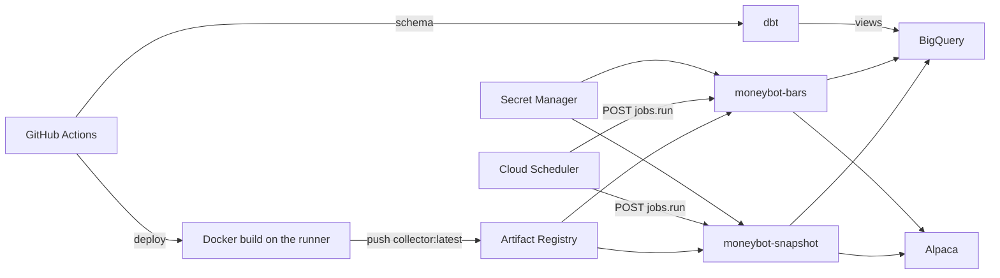

# moneybot

> Live Alpaca bot for **SPY**. It follows the market-on-close pattern Iván Scherman described publicly. Nothing here runs on your laptop. GitHub Actions builds, migrates, and deploys it.

**Today it does not trade.** The only service is `data` (`snapshot` and `bars`). The rules below were in `research/src/strategy.py` and only the local backtest used them. That code was removed in `d15b751` and is still in git history. A `trade` service has to come back before any order is sent.

The 491% from 2023 is the futures World Cup. Those models are not published. This repo is the close replica from the [Business Insider interview](https://www.businessinsider.com/stock-trading-strategy-quant-fund-manager-competition-champion-sp500-return-2024-9): Scherman says his fund does not trade it, and the near copy is the SPY ETF. Execution is option 1 from that note, a market-on-close order.

## Contents

- [Rules](#rules)
- [Services](#services)
- [Jobs](#jobs)
- [Data](#data)
- [Deploy](#deploy)
- [Infrastructure](#infrastructure)

## Rules

These are the rules of `decide()` and of the removed trade job. The signal uses the last trade as today's close. The official close does not exist yet when the job decides. The auction can fill at a different price.

| Check | Action |
| --- | --- |
| Today's 200-day SMA is above yesterday's | Trend is on. The last trade counts as today's close |
| Third down day, and the last price is under yesterday's close | Buy `qty` shares with a `cls` order |
| Long, and the last price is above the 5-day SMA | Sell the whole position with a `cls` order |
| Anything else | Hold |

Also:

- No stop. Size is fixed (`qty`, default 1). If cash cannot cover `qty` times the last price, it does not buy. No margin. No fractions. Alpaca rejects a fractional `cls` order.
- One position. Already long means no buy. Flat means no sell.
- The same order is not sent twice. `client_order_id` is `scherman-spy-{buy|sell}-{date}`.
- The last trade must be under 5 minutes old, and the feed must be SIP. A stale trade or an IEX close aborts the run and sends nothing.

`mode` other than `live`, or `APCA_API_BASE_URL` containing `paper`, aborts the process.

## Services

There is no single app. Each runnable is a directory under `services/`, with its own entrypoint, requirements, `src` package, and `.dockerignore`. The dbt project lives in the service that owns it, at `services/data/dbt`.

| Service | Path | What it runs |
| --- | --- | --- |
| `data` | [`services/data`](services/data) | `snapshot` and `bars`. It does not trade |

`services/data/src` is the Python package. Imports stay `src.*`. CI runs a service's unit tests only when that service has `tests/test_*.py`.

The directory and code say `data`. The image, the Cloud Run jobs, and the workflow `service:` input still say `collector` in [`infra/`](infra) and [`.github/workflows/`](.github/workflows). Those names are unchanged here until the rename lands.

The image build context is the repo root. [`services/data/.dockerignore`](services/data/.dockerignore) allows only the service's `entrypoint.py`, `requirements.txt`, and `src/**/*.py`. The jobs also read `config/bot.yml` and `dbt/models/base/base_bar.yml` at runtime. Tests stay out of the image.

```bash
docker build -f services/data/Dockerfile .
```

## Jobs

The `data` service ships one image. Two Cloud Run jobs. Two Cloud Scheduler triggers in `America/New_York`.

| Job | Default cron | What it does |
| --- | --- | --- |
| `moneybot-snapshot` | `*/15 9-16 * * 1-5` | Reads the account, positions, and open orders. It does not decide and it does not trade |
| `moneybot-bars` | `35 10-16 * * 1-5` | Stores split-adjusted 1-hour SIP bars for the configured symbol. It does not decide and it does not trade. The first run starts at 2016-01-01. Later runs start after the last stored bar, so a missed run fills the gap |

The crons are Terraform variables.

The picture of GCP, and which file owns which resource, is in [Infrastructure](#infrastructure).

## Data

BigQuery dataset `moneybot` in the `US` multi-region (`bq_location`), like every other dataset in the project. BigQuery cannot join across locations. Terraform creates the tables. `deletion_protection` is true on each table, so a column change that would recreate the table stops until that flag is turned off. A dbt model must not reuse these table ids.

| Table | One row is |
| --- | --- |
| `runs` | One execution of any job. `id` is a random id |
| `signals` | The price, both 200-day SMAs, the 5-day SMA, the flags, the action, and the reason |
| `orders` | A `cls` order sent to Alpaca. `client_order_id` is the key the job merges on |
| `account_snapshots` | Equity, cash, buying power, and open orders |
| `position_snapshots` | One open position |
| `base_bar` | One split-adjusted bar. The `bars` job reads the column list from [`services/data/dbt/models/base/base_bar.yml`](services/data/dbt/models/base/base_bar.yml). The lookup key is symbol, feed, timeframe, and the bar open time |

## Deploy

The GCP project already exists. The default region is `us-central1`. Cloud Scheduler must be available there. BigQuery uses `US`. There is no database server to keep running.

**Warning:** If this project already has the Cloud SQL instance `moneybot`, the next `infra` apply tries to delete it. The rows in that instance are not copied into BigQuery. Deletion protection blocks the destroy. Turn the API flag off, drop the Cloud SQL resources from state, delete the instance, then apply again:

```bash
gcloud sql instances patch moneybot --project "$PROJECT_ID" --no-deletion-protection --quiet
terraform -chdir=infra state rm \
  google_sql_database_instance.main \
  google_sql_database.bot \
  google_sql_user.bot
gcloud sql instances delete moneybot --project "$PROJECT_ID" --quiet
```

Create a service account named `moneybot-sa` and download the JSON. Before the first Deploy, grant that account **Storage Admin** and **Project IAM Admin**. Those two let it create the state bucket and then keep its other roles in Terraform. It does not need Owner. In the repo, open **Settings → Secrets and variables → Actions** and add:

| Name | Kind | Value |
| --- | --- | --- |
| `GCP_SA_KEY` | secret | The whole JSON key |
| `GCP_PROJECT_ID` | secret | The project id |
| `ALPACA_KEY` | secret | Alpaca key |
| `ALPACA_SECRET` | secret | Alpaca secret |
| `GCP_REGION` | variable | Optional. Workflows use `us-central1` when it is empty |

Terraform state lives in the bucket `PROJECT_ID-moneybot-tfstate`. Alpaca keys live in GitHub Secrets and in Secret Manager. There is no database password.

A push to `main` runs **Deploy**. That workflow calls [test.yml](.github/workflows/test.yml), then [infra.yml](.github/workflows/infra.yml) with action `infra`, then [build.yml](.github/workflows/build.yml). Build calls [build-service-image.yml](.github/workflows/build-service-image.yml), which has no manual trigger. For `collector` it hashes `Dockerfile` and `requirements.txt`. If `collector-bedrock:<sha>` is missing, the runner builds `--target bedrock`. Then it hashes the service directory, `config/`, and `dbt/models/base/`. If `collector:<sha>` is missing, it builds with `BEDROCK_IMAGE` set to that bedrock URI, so a code change does not reinstall dependencies. Then it moves `collector:latest` to that image. The apply creates Artifact Registry, the BigQuery dataset and tables, Cloud Build IAM, and the empty Alpaca secrets. On the first deploy it does not create the jobs. Once `collector:latest` exists, that apply passes it as `image`, so the jobs stay (an empty `image` would destroy them). After the image push, Build updates every job that runs `collector` to the new content tag, because a job pins the image digest when it is created or updated. If that apply fails because the Cloud Build account or the Scheduler agent does not exist yet, run **Deploy** again.

Then, from **Actions → Infra**, in this order:

1. Action `secrets`. Loads the Alpaca keys into Secret Manager.
2. Action `jobs`. Creates `moneybot-snapshot`, `moneybot-bars`, and their schedulers on `collector:latest`.

Action `schema` runs dbt against BigQuery. The tables already exist after `infra`. A dbt model must not use the table ids `runs`, `signals`, `orders`, `account_snapshots`, `position_snapshots`, or `base_bar`.

Every push and every pull request runs the test workflow. A service with no `tests/test_*.py` is skipped. Every push to `main` publishes the image again. Changing `config/bot.yml` is a push to `main`. That file is not in the tree after `d15b751`. The jobs read it through `BOT_CONFIG` and refuse to run without `mode: live` and `feed: sip`, so it has to be back before the image runs.

## Infrastructure

GCP layout for moneybot. Terraform in `infra/` creates it.

### What `infra/` owns

| File | What it holds |
| --- | --- |
| [`terraform.tf`](infra/terraform.tf) | Terraform and provider version pins |
| [`backend.tf`](infra/backend.tf) | GCS state backend. The bucket name is passed at `init` |
| [`providers.tf`](infra/providers.tf) | Google provider, project, and region |
| [`variables.tf`](infra/variables.tf) | Inputs. An empty `image` skips the jobs |
| [`main.tf`](infra/main.tf) | Every resource |
| [`outputs.tf`](infra/outputs.tf) | Image repository and BigQuery dataset id |

Two applies share this config:

| Apply | `image` | What appears |
| --- | --- | --- |
| `infra` | empty | APIs, registry, BigQuery dataset and tables, secret shells, IAM |
| `jobs` | `collector:latest` | The same, plus the Cloud Run jobs and their schedulers |

Alpaca key values are not in Terraform. The Infra workflow action `secrets` writes those Secret Manager versions. Terraform creates the tables the jobs write. See [Deploy](#deploy).

### Architecture



Scheduler and the jobs run in `America/New_York`. The job uses its own service account to query BigQuery. There is no database socket and no database password.

### Identities

| Account | Used by | Can do |
| --- | --- | --- |
| `moneybot-sa` | GitHub Actions | Apply this config and submit Cloud Build. Roles are `google_project_iam_member.deployer` in [`main.tf`](infra/main.tf) |
| `moneybot-job` | The Cloud Run jobs | Edit the BigQuery dataset, run query jobs, read the two Alpaca secrets, pull the image |
| `moneybot-scheduler` | Cloud Scheduler | Call `jobs.run` |
| Cloud Build service account | `gcloud builds submit` | Push the image, update a job, write logs, act as `moneybot-job` |
| Scheduler service agent | Google-managed | Mint the OAuth token for `moneybot-scheduler` |

The Cloud Build account and the Scheduler agent do not exist until their APIs have been used once. If `infra` 404s on either binding, run `infra` again.

### What stays out of Terraform

- The GCP project. It already exists.
- The state bucket. The Infra workflow creates `PROJECT_ID-moneybot-tfstate` before apply.
- Alpaca secret versions. The Infra workflow action `secrets` adds them.
- The container image. [build-service-image.yml](.github/workflows/build-service-image.yml) builds it on the GitHub runner, from the repo root. A new service adds `services/<service>/Dockerfile` and its `.dockerignore`, and [build.yml](.github/workflows/build.yml) calls Build image with that service name.
